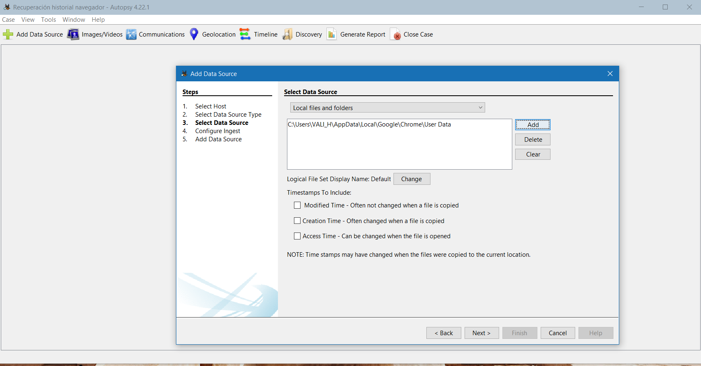
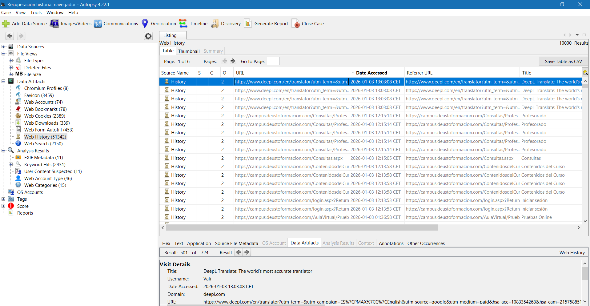
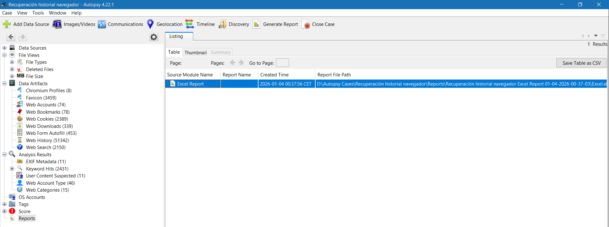
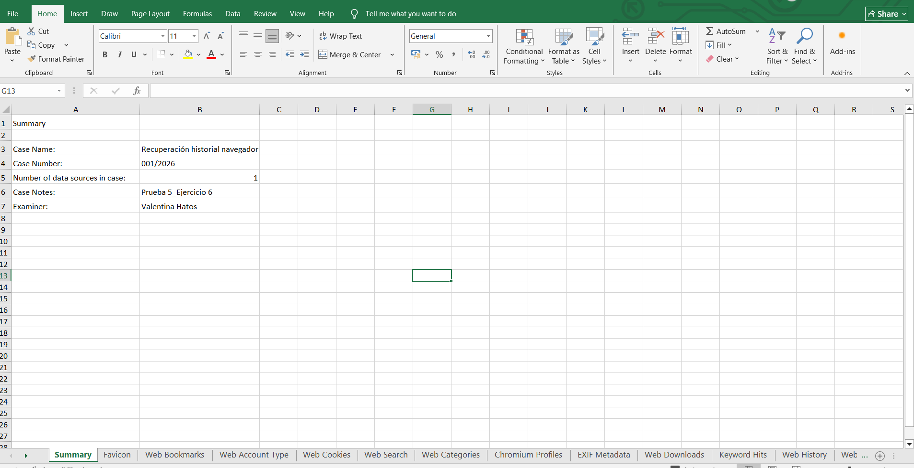

<h1 align="center">Computer Forensic Analysis Report</h1>

Browsing History Recovery with Autopsy Curso Superior de Ciberseguridad – Deusto Formación

<b>Download PDF Documentation:</b> 
<a href="Browsing_History_Recovery_Autopsy_Valentina_Hatos.pdf"><b>[ English Version PDF ]</b></a> 
<a href="Recuperacion_Historial_Navegacion_Autopsy_Valentina_Hatos.pdf"><b>[ Versión en Español PDF ]</b></a>

| Item | Details |
|---|---|
| Code | Test 5_Exercise 6 |
| Authors | Valentina Hatos |
| Date and place | 04/01/2026 – Valencia, Spain |
| Tool used | Autopsy 4.22.1 |

---

## Index

- [Forensic Analysis Report](#forensic-analysis-report)
  - [Purpose](#purpose)
  - [Applicable Standards and Legislation](#applicable-standards-and-legislation)
  - [Terminology](#terminology)
  - [Analysis of Solutions](#analysis-of-solutions)
  - [Final Results](#final-results)
  - [Annexes](#annexes)
- [Annex 1 – Analysis in Autopsy](#annex-1--analysis-in-autopsy)
  - [Analysis in Autopsy](#analysis-in-autopsy)
    - [Create a Case in Autopsy](#create-a-case-in-autopsy)
    - [Add the Data Source](#add-the-data-source)
    - [Viewing the Analysis Results](#viewing-the-analysis-results)
    - [Analysis of the Results](#analysis-of-the-results)
  - [Conclusions](#conclusions)
- [Annex 2 – Applicable Standards and Legislation](#annex-2--applicable-standards-and-legislation)
  - [Applicable Standards and Legislation](#applicable-standards-and-legislation-1)
    - [UNE Standards Applied](#une-standards-applied)
    - [Applicable Spanish Legislation](#applicable-spanish-legislation)
- [Project Files](#project-files)

---

## Forensic Analysis Report

### Purpose

To check whether the Autopsy tool is able to recover the deleted browsing history of a device.

### Applicable Standards and Legislation

UNE 71506:2013, UNE 71505:2013, UNE 197010:2015, Spanish Criminal Code, LSSI-CE, Data Retention Act.

### Terminology

Chain of custody – the set of rules that guarantees that digital evidence remains unaltered and secure from the moment it is acquired until it is no longer needed.

Browsing history – the record of the web pages a user has visited in a browser, including addresses, dates and times.

### Analysis of Solutions

Manual options and Autopsy were evaluated. Autopsy was chosen for its efficiency.

### Final Results

Autopsy recovered URLs, dates and cookies even after conventional deletion.

### Annexes

Annex 1: Analysis in Autopsy

Annex 2: Applicable Standards and Legislation

---

## Annex 1 – Analysis in Autopsy

### Analysis in Autopsy

#### Create a Case in Autopsy

- Run Autopsy as administrator: click the application and select "Run as administrator".
- Select "Create New Case".
- Case name: **Recuperación historial navegador.**
- Define the folder where the results will be saved.

This organises the whole analysis and allows each step to be documented for the report.

#### Add the Data Source

- In Data Source Type, choose "Logical Files".
- In Data Source, add the path to Google – User Data (the folder where the files related to the browsing history are stored).
- Wait for Autopsy to index the data.

#### Viewing the Analysis Results

- Once Autopsy finishes processing and indexing the data, the relevant information related to the browsing history can be viewed in the **Web History** section, located in the left panel of the interface.
- When this category is selected, the right panel shows all the details of each history entry: visited URLs, access dates and times, number of visits and other metadata useful for the investigation.

This organisation allows a quick review and a clear interpretation of the extracted data.

#### Analysis of the Results

- To document the findings and generate a formal report, Autopsy can create a complete report of the analysis with the **Generate Report** option. Autopsy can show deleted but recoverable data.
- The generated report provides a structured and detailed view of all the items identified during the investigation, which is especially useful for preparing an expert report or presenting conclusions.

### Conclusions

The process confirms that Autopsy is effective for recovering deleted browsing history, provided that the preservation and chain of custody protocols are followed. The intervention and acquisition were carried out in accordance with UNE 71506:2013, guaranteeing the integrity of the evidence.

---

## Annex 2 – Applicable Standards and Legislation

### Applicable Standards and Legislation

#### UNE Standards Applied

- **UNE 197010:2015 General criteria for the preparation of expert reports and opinions on Information and Communication Technologies** (ICT), defines how a computer expert report must be written.
- **UNE 71505:2013** is the Reference Framework of Good Practices in the Management of Electronic Evidence. It is divided into three parts:
  - **UNE 71505:2013-1 Vocabulary and general principles**
  - **UNE 71505:2013-2 Good practices in the management of electronic evidence**
  - **UNE 71505:2013-3 Formats and technical mechanisms**
- **UNE 71506:2013 Methodology for the Forensic Analysis of Electronic Evidence**, aims to define the forensic analysis process within the electronic evidence management cycle described in UNE 71505, complementing it.

#### Applicable Spanish Legislation

- **Spanish Criminal Code (Código Penal)**: defines offences such as disclosure of secrets, intellectual property infringements, computer fraud and computer sabotage.
- **Data Retention Act for Electronic Communications and Public Networks (Ley de Conservación de Datos)**: requires telecommunications operators to retain fixed-line, mobile and internet data for twelve months.
- **Information Society Services and Electronic Commerce Act (LSSI-CE)**: its main purpose is to regulate and protect all persons or entities involved in relationships or services carried out over the internet.

---

## Project Files

| File | Description |
|---|---|
| [Browsing_History_Recovery_Autopsy_Valentina_Hatos.pdf](Browsing_History_Recovery_Autopsy_Valentina_Hatos.pdf) | Full report with Annexes 1–2 (English) |
| [Recuperacion_Historial_Navegacion_Autopsy_Valentina_Hatos.pdf](Recuperacion_Historial_Navegacion_Autopsy_Valentina_Hatos.pdf) | Full report with Annexes 1–2 (Spanish) |
| [images](images) | Autopsy and Excel report screenshots used in this document |
