<h1 align="center">Computer Forensic Analysis Expert Report – USB Pendrive</h1>

<p align="center">Final Project (Option B) – Curso Superior de Ciberseguridad, Deusto Formación</p>

<p align="center">
<b>Download PDF Documentation:</b><br>
<a href="Final_Project_USB_Forensic_Analysis_Valentina_Hatos.pdf"><b>[ English Version PDF ]</b></a><br>
<a href="Proyecto_Final_Analisis_Forense_USB_Valentina_Hatos.pdf"><b>[ Versión en Español PDF ]</b></a>
</p>

| Item | Details |
|---|---|
| Code | CASE_USB_B_2026 |
| Requester | Deusto Final Project – Option B |
| Authors | Valentina Hatos |
| Date and place | 05/01/2026 – Valencia, Spain |

---

## Index

- [Expert Report](#expert-report)
  - [Purpose](#purpose)
  - [Scope](#scope)
  - [Background](#background)
  - [Applicable Standards and Legislation](#applicable-standards-and-legislation)
  - [Terminology](#terminology)
  - [Requirements](#requirements)
  - [Methodology and Analysis of Solutions](#methodology-and-analysis-of-solutions)
  - [Final Results](#final-results)
  - [Conclusions](#conclusions)
  - [Annexes](#annexes)
- [Annex 1 – Analysis in Autopsy](#annex-1--analysis-in-autopsy)
  - [Physical Identification of the Digital Evidence](#physical-identification-of-the-digital-evidence)
  - [Technical Description of the Analysed USB Device](#technical-description-of-the-analysed-usb-device)
  - [Intervention on the Digital Evidence](#intervention-on-the-digital-evidence)
  - [Forensic Acquisition of the USB Device (Creation of the E01 Image)](#forensic-acquisition-of-the-usb-device-creation-of-the-e01-image)
  - [Analysis of the Device Content](#analysis-of-the-device-content)
  - [Exploration and Scanning of the Pendrive Content](#exploration-and-scanning-of-the-pendrive-content)
  - [File Extraction and Generation of Results](#file-extraction-and-generation-of-results)
  - [Recovery of Deleted Files](#recovery-of-deleted-files)
  - [Creation of a Dedicated Directory for the Recovered Evidence](#creation-of-a-dedicated-directory-for-the-recovered-evidence)
  - [Collection of File Metadata](#collection-of-file-metadata)
- [Annex 2 – Analysis of the Recovered Files](#annex-2--analysis-of-the-recovered-files)
  - [File: Locuinta exemple.docx](#file-locuinta-exempledocx)
    - [File Metadata](#file-metadata)
    - [Data Artifacts](#data-artifacts)
  - [File: Lunile anului.jpg](#file-lunile-anuluijpg)
    - [File Metadata](#file-metadata-1)
    - [Data Artifacts](#data-artifacts-1)
  - [File: f0011512.pdf](#file-f0011512pdf)
    - [File Metadata](#file-metadata-2)
    - [Data Artifacts](#data-artifacts-2)
- [Annex 3 – Applicable Standards and Legislation](#annex-3--applicable-standards-and-legislation)
  - [Applicable Standards and Legislation](#applicable-standards-and-legislation-1)
    - [UNE Standards Applied](#une-standards-applied)
    - [Applicable Spanish Legislation](#applicable-spanish-legislation)
- [Project Files](#project-files)

---

## Expert Report

### Purpose

To carry out the computer forensic analysis of a 125 MB USB pendrive, brand VendorCo ProductCode USB Device, in order to identify, preserve, analyse and present digital evidence in accordance with UNE standards and Spanish legislation.

### Scope

Phases: Preservation, acquisition (cloning planned), documentation, analysis and presentation.

Evidence: Pendrive EVI-USB-001 and its main partition.

Tools: Autopsy and FTK Imager.

### Background

Removable devices are common in judicial investigations. It is essential to guarantee preservation, chain of custody and traceability.

### Applicable Standards and Legislation

UNE 71506:2013, UNE 71505:2013, UNE 197010:2015, Spanish Criminal Code, LSSI-CE, Data Retention Act.

### Terminology

Chain of custody – the set of rules that guarantees that digital evidence remains unaltered and secure from the moment it is acquired until it is no longer needed.

Digital evidence – digitally stored data that can be used as proof.

Cloned image – an exact, bit-by-bit copy of a storage device, such as a hard drive.

Metadata – data about data (author, dates, EXIF, GPS).

### Requirements

Device: Pendrive EVI-USB-001

Environment: Autopsy

### Methodology and Analysis of Solutions

Installation and use of Autopsy as the main tool.

Full extraction of the pendrive content.

Recovery of deleted files using the **Extract** function.

Collection of metadata to guarantee the authenticity of the files.

Thorough documentation of each phase, following the chain of custody.

### Final Results

Relevant files

Metadata

Files with extension ↔ signature mismatch

Recovered deleted files

### Conclusions

The computer forensic analysis of pendrive **EVI-USB-001** was carried out following rigorous preservation, acquisition and analysis procedures. The recovered files and the metadata obtained constitute valid and verifiable digital evidence, which can be used in the context of a cybercrime investigation.

All information has been documented and filed in the case record, including:

- E01 forensic image
- Recovered files
- Metadata CSV files
- Screenshots

### Annexes

Annex 1: Analysis in Autopsy

Annex 2: Analysis of the Recovered Files

Annex 3: Applicable Standards and Legislation

CASE_USB_B_2026 – the case folder generated automatically by Autopsy

CLONE USB – the folder that stores the forensic image

Recovered Deleted Files – the folder with the three recovered files

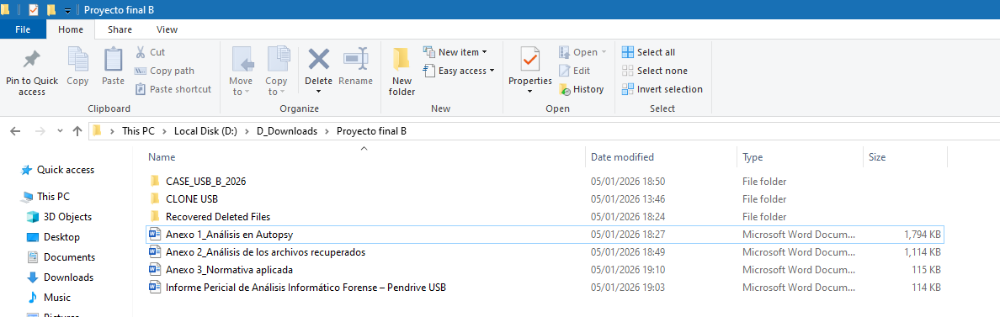

---

## Annex 1 – Analysis in Autopsy

### Physical Identification of the Digital Evidence

To guarantee the correct preservation and traceability of the evidence, the USB device was physically identified at the moment it was received.

- A **tamper-evident label** with the unique code **EVI-USB-001** was attached to the body of the device.
- A **photograph of the pendrive** was taken, clearly showing:
  - The USB device
  - The EVI-USB-001 label
  - The general physical condition of the device (no visible damage, no external alterations)

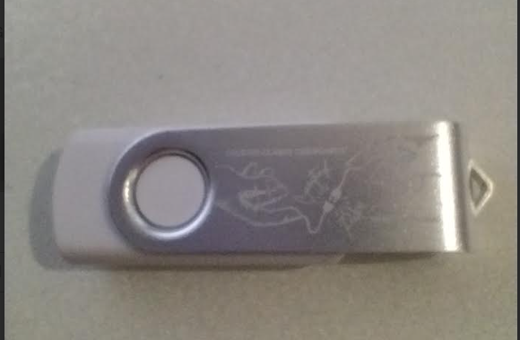

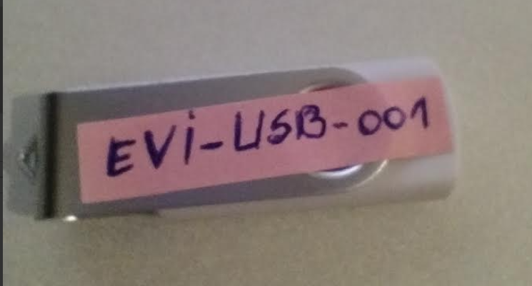

### Technical Description of the Analysed USB Device

The analysed device is a USB storage device with the following technical characteristics:

- **Device name:** VendorCo ProductCode USB Device
- **Type:** USB Drive
- **Total capacity:** 125 MB
- **Used space:** 15.8 MB
- **File system:** NTFS
- **Identifier assigned by the system:** USB Drive (E:)
- **Physical drive number:** `\\.\PHYSICALDRIVE1`

Screenshots of the device content were taken before any forensic intervention, showing the directory structure and the visible files.

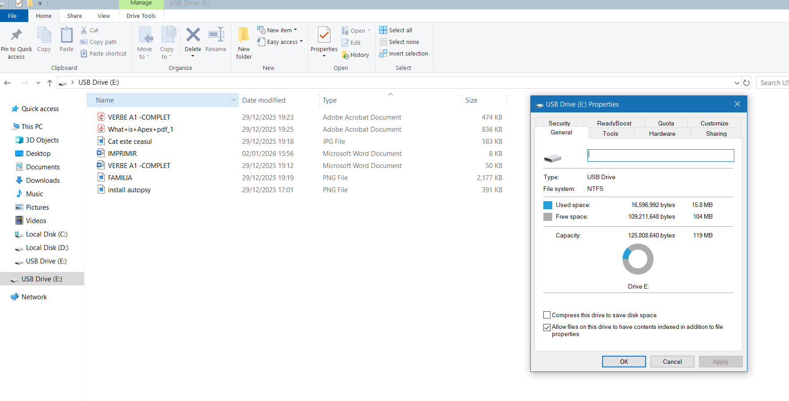

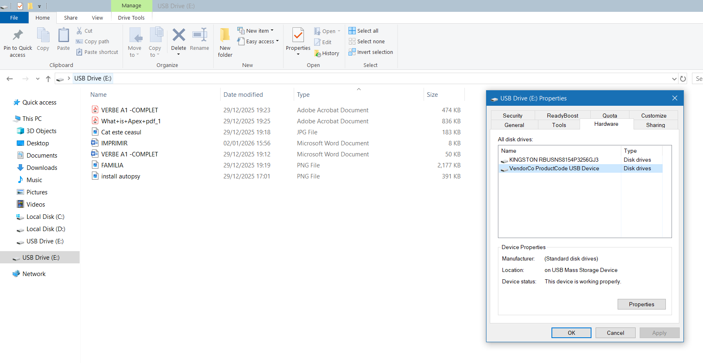

### Intervention on the Digital Evidence

The intervention was carried out strictly following the digital evidence preservation protocols accepted in the forensic field:

- **The USB device was removed from the original computer** using gloves to avoid physical contamination and fingerprints.
- **Tamper-evident labels were applied** to secure the integrity of the device during the whole process.
- **The retention of the device was recorded** in the official **chain of custody** document, including:

These measures guarantee that the evidence has not been altered from its collection to its analysis.

### Forensic Acquisition of the USB Device (Creation of the E01 Image)

The forensic acquisition was carried out following the principles of repeatability, integrity and non-alteration of the evidence, guaranteeing that the content of the USB device could be analysed without any risk of modification.

**Preparation of the environment:** the USB device identified as **EVI-USB-001** was connected to a dedicated forensic analysis computer.

**Tool used:** the acquisition was performed with the forensic tool **FTK Imager**, widely accepted in the expert-witness field for its ability to generate bit-by-bit images and the associated metadata.

**Acquisition procedure:**

The physical device corresponding to the USB was selected: **`\\.\PHYSICALDRIVE1` – VendorCo ProductCode USB Device [125 MB]**

The output format **E01 (EnCase Evidence File)** was chosen, which allows:

- Efficient compression
- Inclusion of case metadata
- Automatic generation of hash values

A secure directory was specified to store the forensic image: `D:\D_Downloads\Proyecto final B\CLONE USB`.

The case identification fields were completed (case number, responsible examiner, evidence description).

The acquisition process was started, generating a bit-by-bit copy of the device.

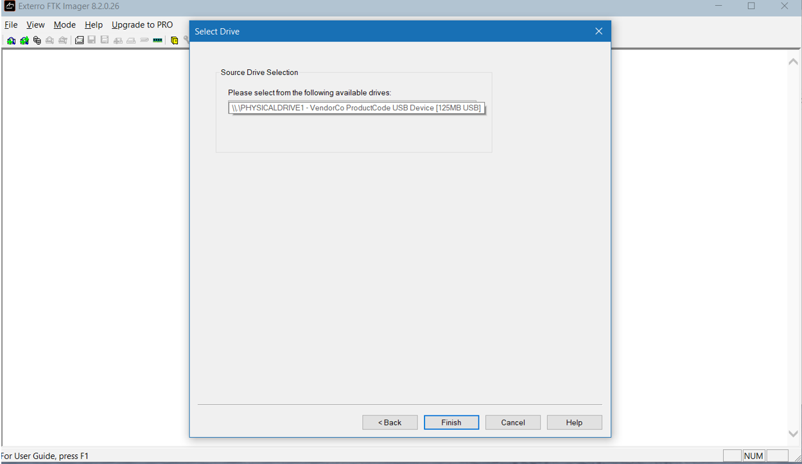

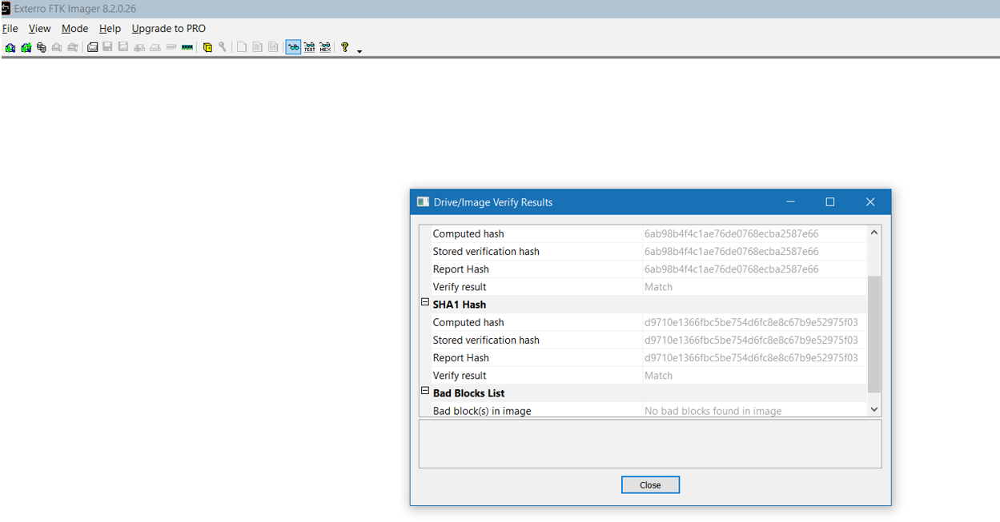

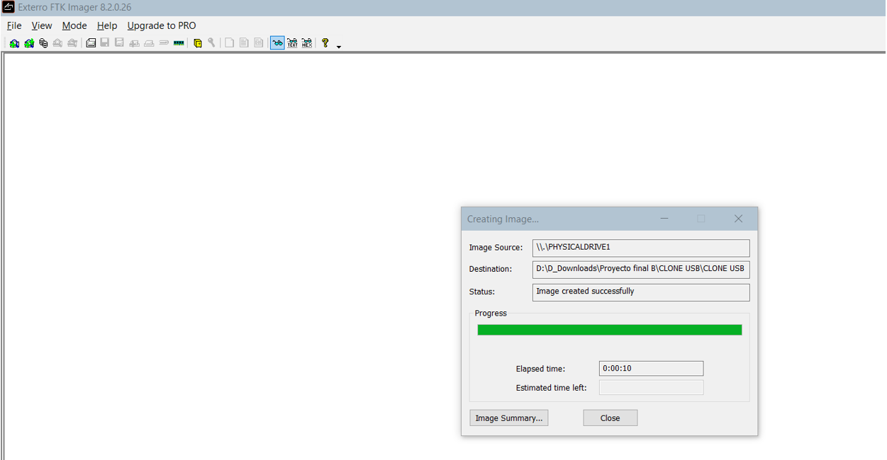

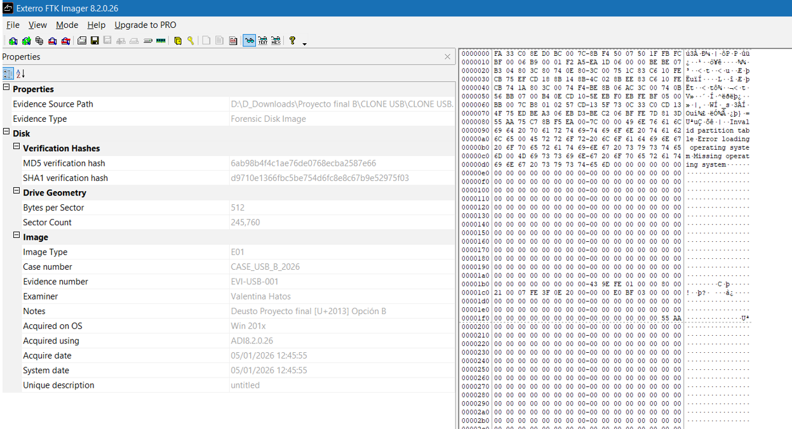

### Analysis of the Device Content

Tool used: **Autopsy**

The analysis of the USB device content was carried out using **Autopsy**, a tool that allows the examination of both visible files and files that have been deleted but can still be recovered from unallocated space.

A new case was created in Autopsy: **CASE_USB_B_2026**

The previously generated **E01** forensic image was added as Data Source: **CLONE USB**

Autopsy automatically performed:

- Content indexing
- File system analysis
- Artifact identification
- Detection of deleted files

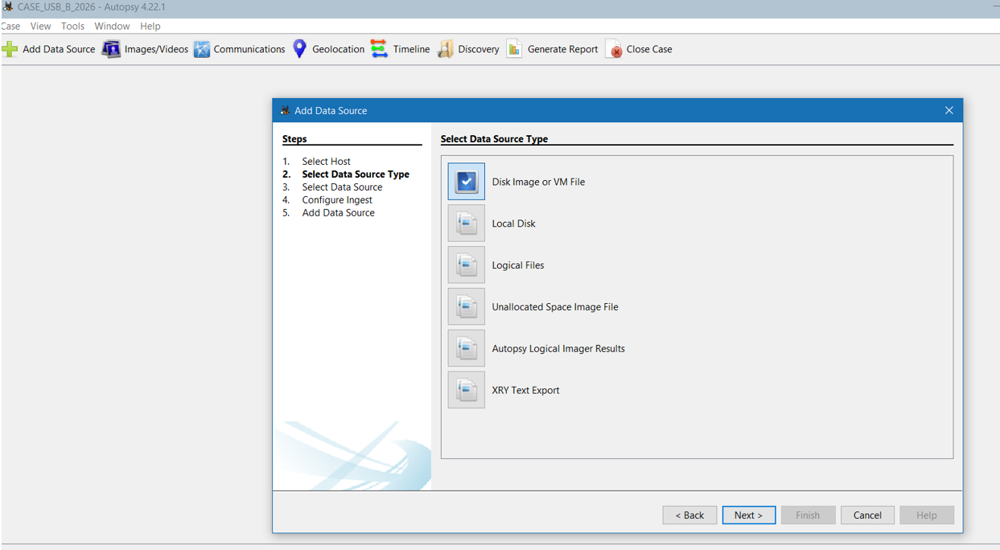

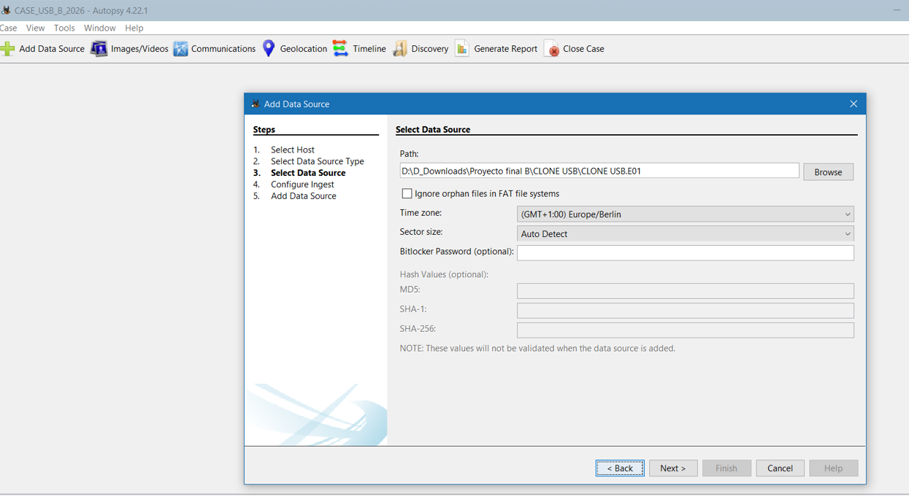

### Exploration and Scanning of the Pendrive Content

Autopsy performed a full scan of the file system, identifying:

- Visible files in the root directory and subdirectories
- Deleted files that can still be recovered
- Unallocated space
- File types and internal signatures
- Associated metadata (MAC times, size, MIME type, individual hash)

The analysis made it possible to reconstruct the logical structure of the USB device and to view all the elements present at the moment of acquisition.

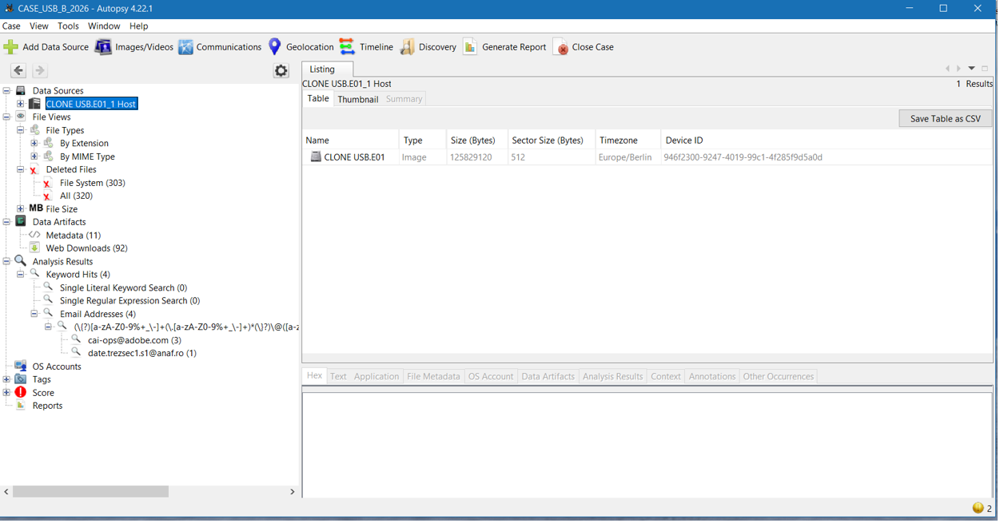

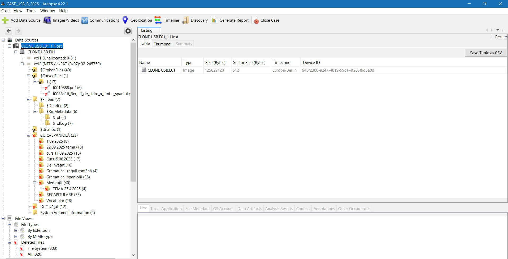

### File Extraction and Generation of Results

To document and preserve the information obtained, the following steps were carried out:

- The lists of visible and deleted files were exported in **.CSV** format
- These files were saved inside the case directory generated automatically by Autopsy

The .CSV files contain detailed information about:

- File name
- Path inside the device
- Status (visible or deleted)
- Size
- Creation, modification and access dates
- File type
- Individual hash

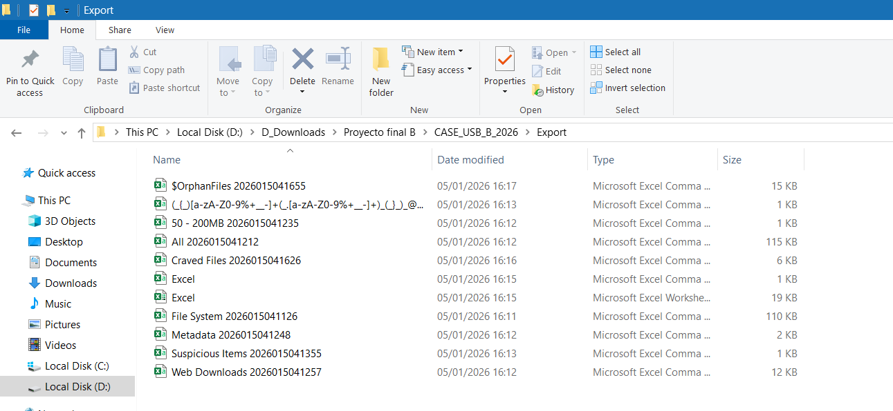

Autopsy made it possible to create a full logical copy of the pendrive content, identifying both visible and deleted files and generating a complete set of results stored in a secure directory on the analysis computer. This phase guarantees that all the information on the device has been preserved and properly documented for later analysis.

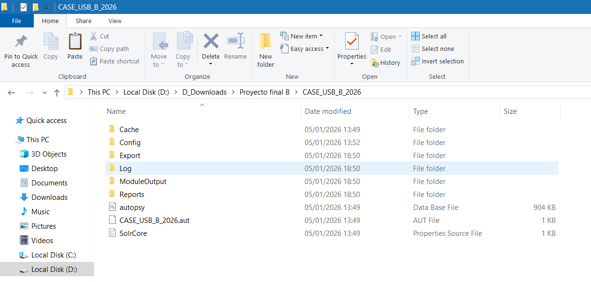

### Recovery of Deleted Files

During the forensic analysis of the pendrive, several deleted files were identified that could still be recovered from the E01 forensic image. Among them, **three files showing signs of evidential relevance in the context of a possible cybercrime** were located, so it was considered necessary to recover them for detailed analysis.

The files identified as digital evidence were:

- **Lunile anului.jpg**
- **f0011512.pdf**
- **Locuinta exemple.docx**

Although these items had been deleted from the original device, they retained enough integrity to be extracted and analysed.

The recovery was performed with **Autopsy**, in the **Deleted Files** section. The following function was applied to each of the files identified as digital evidence: **Extract File(s).**

This procedure made it possible to obtain exact copies of the deleted files without modifying the forensic image or the original device at any time.

### Creation of a Dedicated Directory for the Recovered Evidence

To keep a clear organisation and preserve the traceability of the analysis, a dedicated directory was created inside the project: **Recovered Deleted Files.**

The three recovered files were stored in this directory:

- *Lunile anului.jpg*
- *f0011512.pdf*
- *Locuinta exemple.docx*

The recovered files were NOT restored or copied to the original pendrive, and the whole recovery was carried out exclusively on the E01 forensic image, guaranteeing the integrity of the digital evidence.

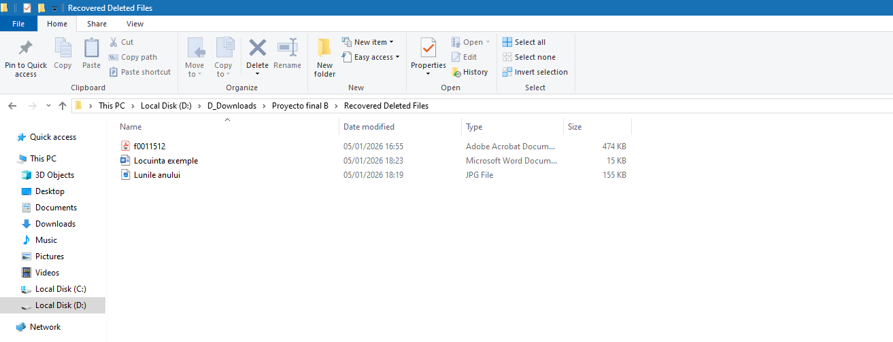

The three deleted files identified as digital evidence of a possible cybercrime were successfully recovered with Autopsy and stored in a secure directory for later analysis. This phase ensures that the potentially relevant information has been preserved and is available for detailed study in the following stages of the report.

### Collection of File Metadata

Metadata is essential information for reconstructing user activity, determining the chronology of events and establishing the authenticity and integrity of the examined files.

Autopsy allows file information to be exported in **.CSV** format, which makes its analysis and inclusion in the forensic record easier. Several CSV files were generated, including:

- Full list of visible files
- List of deleted files
- Detailed metadata for each file
- Information about the pendrive file system

These files were saved in the case directory, inside the structure generated automatically by Autopsy.

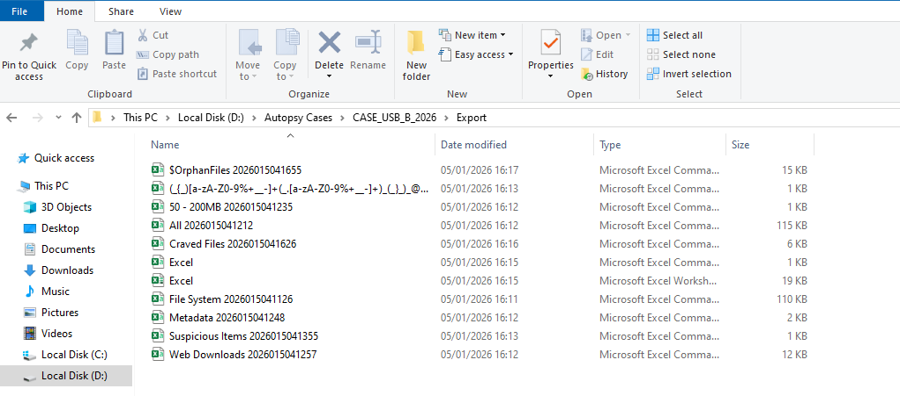

The extraction and documentation of the metadata was carried out completely and systematically, guaranteeing that all the relevant information associated with the pendrive files, both visible and deleted, has been preserved and recorded for later analysis. This phase provides a solid basis for forensic interpretation and for drawing conclusions based on verifiable data.

---

## Annex 2 – Analysis of the Recovered Files

This annex presents the detailed analysis of the three files recovered with Autopsy Forensic Browser. For each file, the metadata and the associated artifacts were examined, using the **File Metadata** and **Data Artifacts** sections available in the Autopsy interface.

The analysed files are:

- **Locuinta exemple.docx**
- **Lunile anului.jpg**
- **f0011512.pdf**

### File: Locuinta exemple.docx

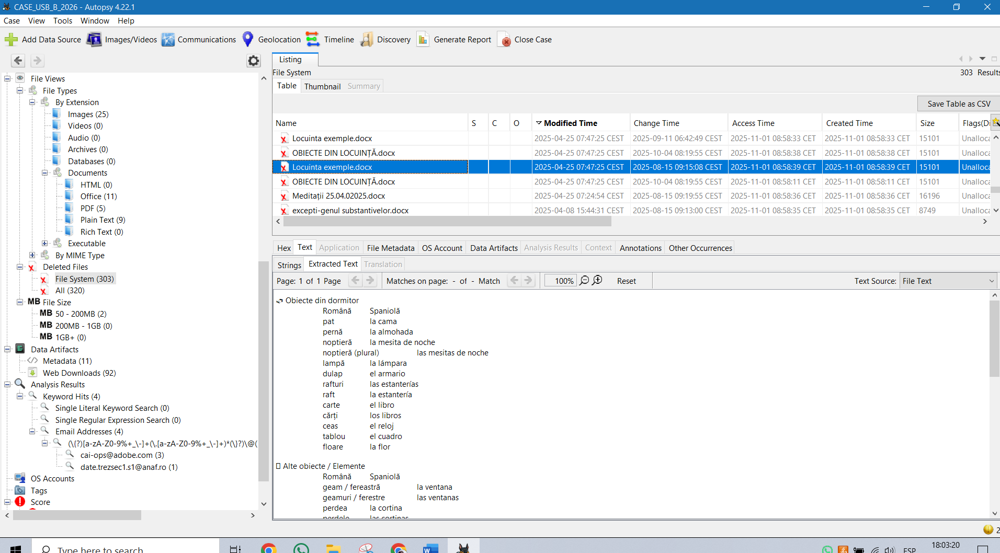

#### File Metadata

**Metadata**

| Field | Value |
|---|---|
| Name: | /img_CLONE USB.E01/vol_vol2/CURS-SPANIOLĂ/Vocabular/Locuinta exemple.docx |
| Type: | File System |
| MIME Type: | application/vnd.openxmlformats-officedocument.wordprocessingml.document |
| Size: | 15101 |
| File Name Allocation: | Unallocated |
| Metadata Allocation: | Unallocated |
| Modified: | 2025-04-25 07:47:25 CEST |
| Accessed: | 2025-11-01 08:58:39 CET |
| Created: | 2025-11-01 08:58:39 CET |
| Changed: | 2025-08-15 09:15:08 CEST |
| MD5: | 99c3c76bdf3a1ba4ce98e9d64444b956 |
| SHA-256: | db6abcbaf0ef5a063fd8a58cc7efb72484df9951d87625fff69e68a6d3770ead |
| Hash Lookup Results: | UNKNOWN |
| Internal ID: | 471 |

**From The Sleuth Kit istat Tool:**

```text
MFT Entry Header Values:
Entry: 228 Sequence: 2
$LogFile Sequence Number: 2113708
Not Allocated File
Links: 1

$STANDARD_INFORMATION Attribute Values:
Flags: Archive
Owner ID: 0
Security ID: 265 (S-1-5-21-4168738367-1049065326-25058259-1001)
Created: 2025-11-01 09:58:39.841131100 (CES)
File Modified: 2025-04-25 07:47:25.927483800 (CES)
MFT Modified: 2025-08-15 09:15:08.326825900 (CES)
Accessed: 2025-11-01 09:58:39.849188800 (CES)

$FILE_NAME Attribute Values:
Flags: Archive
Name: Locuinta exemple.docx
Parent MFT Entry: 223 Sequence: 1
Allocated Size: 16384 Actual Size: 0
Created: 2025-11-01 09:58:39.841131100 (CES)
File Modified: 2025-11-01 09:58:39.841131100 (CES)
MFT Modified: 2025-11-01 09:58:39.841131100 (CES)
Accessed: 2025-11-01 09:58:39.841131100 (CES)

Attributes:
Type: $STANDARD_INFORMATION (16-0) Name: N/A Resident size: 72
Type: $FILE_NAME (48-2) Name: N/A Resident size: 108
Type: $DATA (128-1) Name: N/A Non-Resident size: 15101 init_size: 15101
Starting address: 4531, length: 4
```

#### Data Artifacts

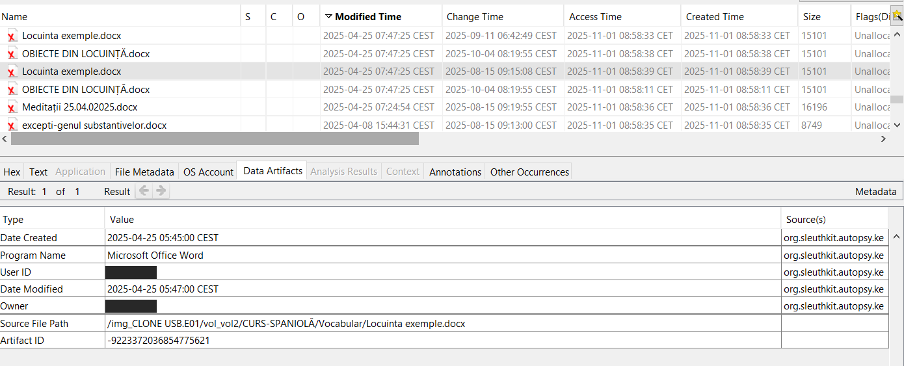

### File: Lunile anului.jpg

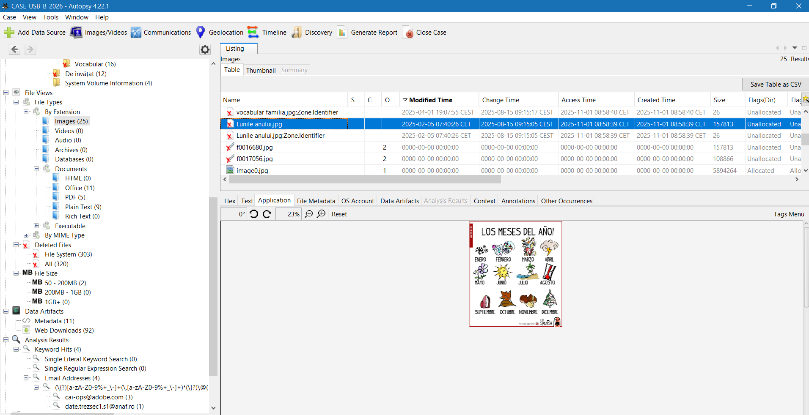

#### File Metadata

**Metadata**

| Field | Value |
|---|---|
| Name: | /img_CLONE USB.E01/vol_vol2/CURS-SPANIOLĂ/Vocabular/Lunile anului.jpg |
| Type: | File System |
| MIME Type: | image/jpeg |
| Size: | 157813 |
| File Name Allocation: | Unallocated |
| Metadata Allocation: | Unallocated |
| Modified: | 2025-02-05 07:40:26 CET |
| Accessed: | 2025-11-01 08:58:39 CET |
| Created: | 2025-11-01 08:58:39 CET |
| Changed: | 2025-08-15 09:15:05 CEST |
| MD5: | 7fd48755e405084bf2a5b0ce135b8a3b |
| SHA-256: | 403cd05a7657a258f9896ee6cebf6c87b5bcc586c73bd814be56e5acdf5bc4f6 |
| Hash Lookup Results: | UNKNOWN |
| Internal ID: | 473 |
| Downloaded From: | |

**From The Sleuth Kit istat Tool:**

```text
MFT Entry Header Values:
Entry: 229 Sequence: 2
$LogFile Sequence Number: 2113783
Not Allocated File
Links: 1

$STANDARD_INFORMATION Attribute Values:
Flags: Archive
Owner ID: 0
Security ID: 265 (S-1-5-21-4168738367-1049065326-25058259-1001)
Created: 2025-11-01 09:58:39.866566400 (CES)
File Modified: 2025-02-05 07:40:26.757758800 (CET)
MFT Modified: 2025-08-15 09:15:05.606843900 (CES)
Accessed: 2025-11-01 09:58:39.908249400 (CES)

$FILE_NAME Attribute Values:
Flags: Archive
Name: Lunile anului.jpg
Parent MFT Entry: 223 Sequence: 1
Allocated Size: 159744 Actual Size: 0
Created: 2025-11-01 09:58:39.866566400 (CES)
File Modified: 2025-11-01 09:58:39.866566400 (CES)
MFT Modified: 2025-11-01 09:58:39.866566400 (CES)
Accessed: 2025-11-01 09:58:39.866566400 (CES)

Attributes:
Type: $STANDARD_INFORMATION (16-0) Name: N/A Resident size: 72
Type: $FILE_NAME (48-2) Name: N/A Resident size: 100
Type: $DATA (128-1) Name: N/A Non-Resident size: 157813 init_size: 157813
Starting address: 4535, length: 39
Type: $DATA (128-3) Name: Zone.Identifier Resident size: 26
```

#### Data Artifacts

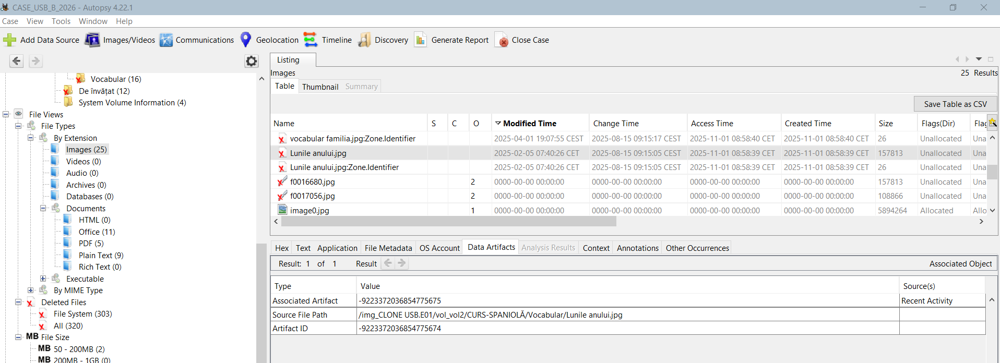

### File: f0011512.pdf

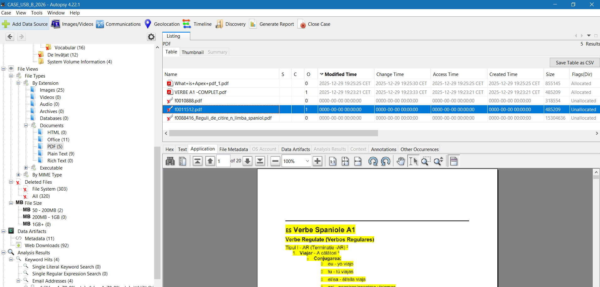

#### File Metadata

**Metadata**

| Field | Value |
|---|---|
| Name: | /img_CLONE USB.E01/vol_vol2/$CarvedFiles/1/f0011512.pdf |
| Type: | Carved |
| MIME Type: | application/pdf |
| Size: | 485209 |
| File Name Allocation: | Unallocated |
| Metadata Allocation: | Unallocated |
| Modified: | 0000-00-00 00:00:00 |
| Accessed: | 0000-00-00 00:00:00 |
| Created: | 0000-00-00 00:00:00 |
| Changed: | 0000-00-00 00:00:00 |
| MD5: | 5ab853e8c0f574cdf3d2c09aa00b1c45 |
| SHA-256: | 3a70c0ee56d18b703f141b302e5e7c621ec918ce34b3f45a33cbc8afab400c04 |
| Hash Lookup Results: | UNKNOWN |
| Internal ID: | 748 |

#### Data Artifacts

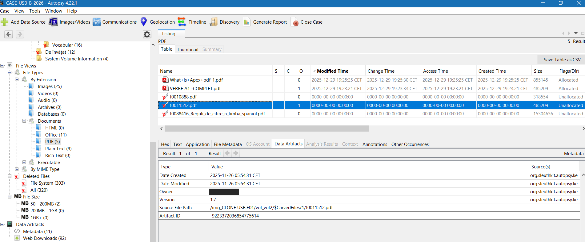

The detailed analysis of the three recovered files made it possible to identify relevant metadata and internal artifacts that may provide significant information in the context of the possible cybercrime under investigation. All information has been documented with screenshots and is kept in the forensic case record.

---

## Annex 3 – Applicable Standards and Legislation

### Applicable Standards and Legislation

#### UNE Standards Applied

- **UNE 197010:2015 General criteria for the preparation of expert reports and opinions on Information and Communication Technologies** (ICT), defines how a computer expert report must be written.
- **UNE 71505:2013** is the Reference Framework of Good Practices in the Management of Electronic Evidence. It is divided into three parts:
  - **UNE 71505:2013-1 Vocabulary and general principles**
  - **UNE 71505:2013-2 Good practices in the management of electronic evidence**
  - **UNE 71505:2013-3 Formats and technical mechanisms**
- **UNE 71506:2013 Methodology for the Forensic Analysis of Electronic Evidence**, aims to define the forensic analysis process within the electronic evidence management cycle described in UNE 71505, complementing it.

#### Applicable Spanish Legislation

- **Spanish Criminal Code (Código Penal)**: defines offences such as disclosure of secrets, intellectual property infringements, computer fraud and computer sabotage.
- **Data Retention Act for Electronic Communications and Public Networks (Ley de Conservación de Datos)**: requires telecommunications operators to retain fixed-line, mobile and internet data for twelve months.
- **Information Society Services and Electronic Commerce Act (LSSI-CE)**: its main purpose is to regulate and protect all persons or entities involved in relationships or services carried out over the internet.

---

## Project Files

| File | Description |
|---|---|
| [Final_Project_USB_Forensic_Analysis_Valentina_Hatos.pdf](Final_Project_USB_Forensic_Analysis_Valentina_Hatos.pdf) | Full expert report with Annexes 1–3 (English) |
| [Proyecto_Final_Analisis_Forense_USB_Valentina_Hatos.pdf](Proyecto_Final_Analisis_Forense_USB_Valentina_Hatos.pdf) | Full expert report with Annexes 1–3 (Spanish) |
| [CLONE_USB_E01.txt](CLONE_USB_E01.txt) | FTK Imager acquisition log with the MD5 and SHA1 verification hashes |
| [images](images) | Screenshots used in this document |
