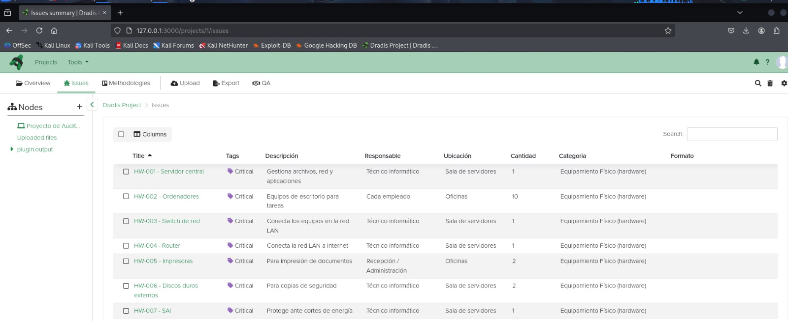
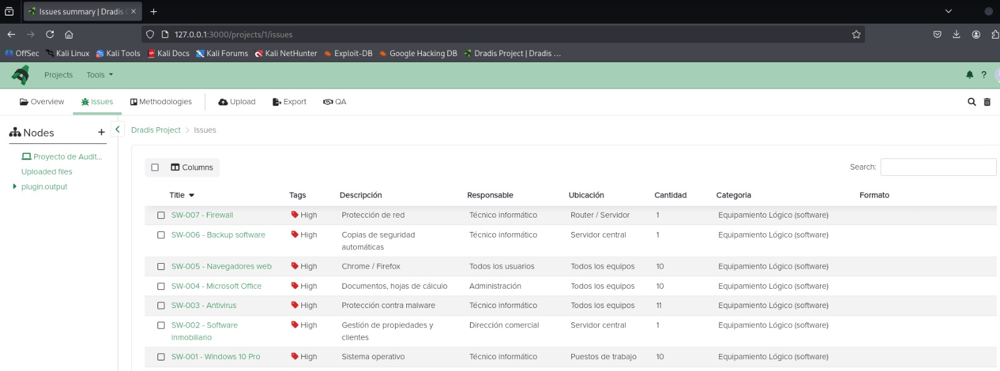
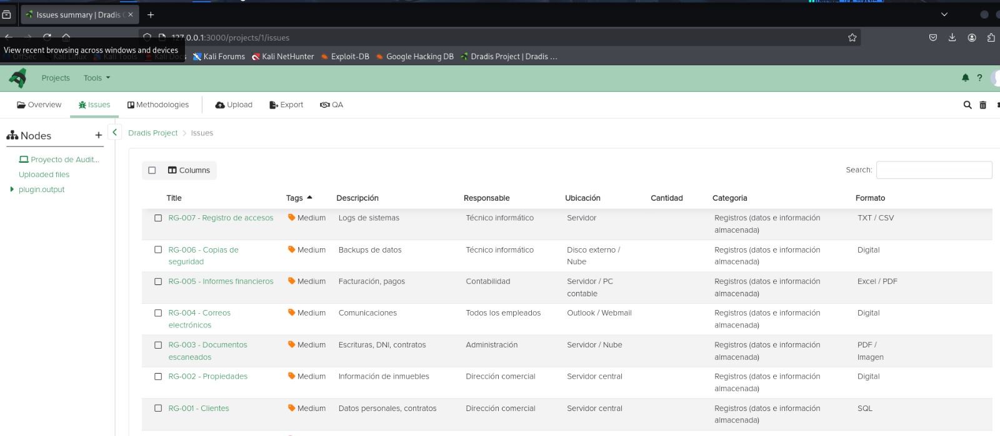
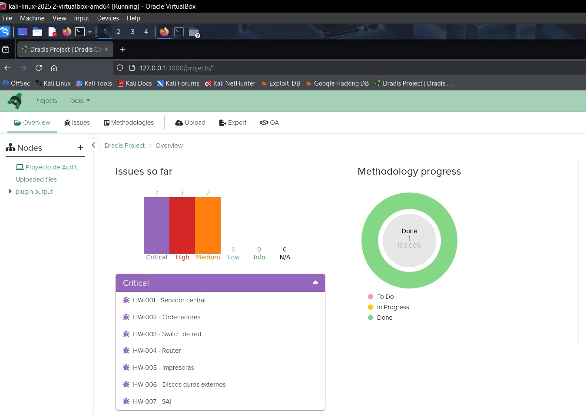
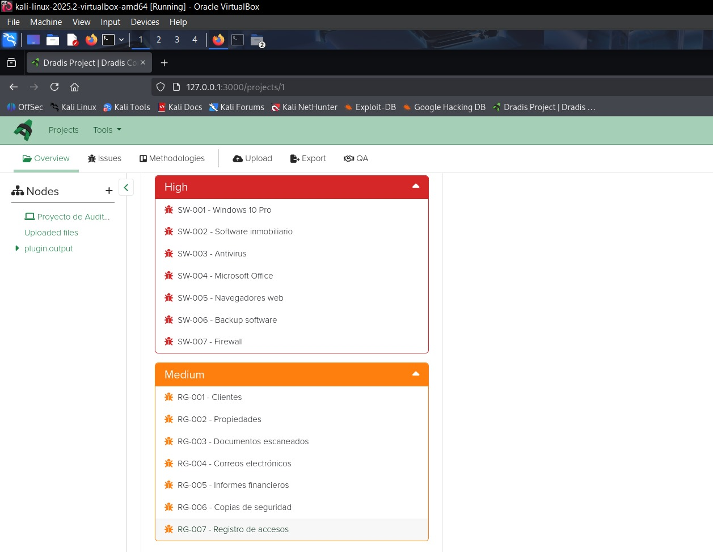

<h1 align="center">Information Asset Identification Report</h1>

Real Estate Agency – IT Security Audit Curso Superior de Ciberseguridad – Deusto Formación

<b>Download PDF Documentation:</b> 
<a href="Information_Asset_Identification_Valentina_Hatos.pdf"><b>[ English Version PDF ]</b></a> 
<a href="Identificacion_Activos_Informacion_Valentina_Hatos.pdf"><b>[ Versión en Español PDF ]</b></a>

| Item | Details |
|---|---|
| Client | Real Estate Agency – IT Security Audit |
| Tool used | Dradis Framework |
| Date | 24 August 2025 |
| Auditor | Valentina Hatos |

---

## Index

- [Purpose of the Report](#purpose-of-the-report)
- [Description of the Technology Infrastructure](#description-of-the-technology-infrastructure)
- [Identification of Information Assets](#identification-of-information-assets)
  - [Physical Equipment Inventory](#physical-equipment-inventory)
  - [Logical Equipment Inventory](#logical-equipment-inventory)
  - [Records Inventory](#records-inventory)
- [Identification Methodology](#identification-methodology)
- [Evidence](#evidence)
- [Observations and Risks Identified](#observations-and-risks-identified)
- [Initial Recommendations](#initial-recommendations)
- [Conclusion](#conclusion)
- [Project Files](#project-files)

---

## Purpose of the Report

The purpose of this report is to identify and classify the information assets of the real estate agency, in order to assess their level of risk exposure and establish appropriate protection measures. This stage is essential within the IT security audit process.

## Description of the Technology Infrastructure

The real estate agency has the following infrastructure:

- **Internal LAN** that connects all the devices.
- **Central server** that manages the database, shared files and internal services.
- **10 workstations** distributed across the office, used by the administrative and sales staff.

## Identification of Information Assets

### Physical Equipment Inventory

This section details the physical devices that are part of the real estate agency's IT infrastructure. Each asset has been assigned a unique code to make tracking and management easier.

| Code | Asset name | Description | Responsible | Location | Quantity |
|---|---|---|---|---|---|
| HW-001 | Central server | Manages files, network and applications | IT technician | Server room | 1 |
| HW-002 | Computers | Desktop computers for daily work | Each employee | Offices | 10 |
| HW-003 | Network switch | Connects the computers to the LAN | IT technician | Server room | 1 |
| HW-004 | Router | Connects the LAN to the internet | IT technician | Server room | 1 |
| HW-005 | Printers | For printing documents | Reception / Administration | Offices | 2 |
| HW-006 | External hard drives | For backups | IT technician | Server room | 2 |
| HW-007 | UPS | Protects against power outages | IT technician | Server room | 1 |

### Logical Equipment Inventory

This section includes the programs, operating systems and applications used by the company for its daily operations.

| Code | Asset name | Description | Responsible | Location | Quantity |
|---|---|---|---|---|---|
| SW-001 | Windows 10 Pro | Operating system | IT technician | Workstations | 10 |
| SW-002 | Real estate software | Property and client management | Sales management | Central server | 1 |
| SW-003 | Antivirus | Malware protection | IT technician | All devices | 11 |
| SW-004 | Microsoft Office | Documents, spreadsheets | Administration | All devices | 10 |
| SW-005 | Web browsers | Chrome / Firefox | All users | All devices | 10 |
| SW-006 | Backup software | Automatic backups | IT technician | Central server | 1 |
| SW-007 | Firewall | Network protection | IT technician | Router / Server | 1 |

### Records Inventory

This section identifies the data and information handled by the company, both in digital format and in databases.

| Code | Record name | Description | Responsible | Location | Format |
|---|---|---|---|---|---|
| RG-001 | Clients | Personal data, contracts | Sales management | Central server | SQL |
| RG-002 | Properties | Property information | Sales management | Central server | Digital |
| RG-003 | Scanned documents | Title deeds, ID documents (DNI), contracts | Administration | Server / Cloud | PDF / Image |
| RG-004 | Emails | Communications | All employees | Outlook / Webmail | Digital |
| RG-005 | Financial reports | Invoicing, payments | Accounting | Server / Accounting PC | Excel / PDF |
| RG-006 | Backups | Data backups | IT technician | External drive / Cloud | Digital |
| RG-007 | Access log | System logs | IT technician | Server | TXT / CSV |

## Identification Methodology

The identification was carried out through:

- Physical review of the infrastructure.
- Interviews with the staff.
- Analysis of internal documentation.
- Use of **Dradis Framework**

## Evidence

Screenshots taken from Dradis Framework are attached, showing the "issues" created for each identified asset. This evidence supports the existence and status of the assets.

## Observations and Risks Identified

- Some workstations do not have up-to-date antivirus software.
- The server does not have an automated daily backup.
- Shared documents are not encrypted.
- The staff have not received recent IT security training.

## Initial Recommendations

- Implement backup and recovery policies.
- Update the security software on all devices.
- Train the staff in good security practices.
- Classify the assets according to their criticality and apply appropriate controls.

## Conclusion

Asset identification is an essential step to protect the critical information of the real estate agency. This report provides a solid basis for continuing with the risk analysis and the implementation of security measures.

---

## Project Files

| File | Description |
|---|---|
| [Information_Asset_Identification_Valentina_Hatos.pdf](Information_Asset_Identification_Valentina_Hatos.pdf) | Full report (English) |
| [Identificacion_Activos_Informacion_Valentina_Hatos.pdf](Identificacion_Activos_Informacion_Valentina_Hatos.pdf) | Full report (Spanish) |
| [images](images) | Dradis Framework screenshots used in this document |
