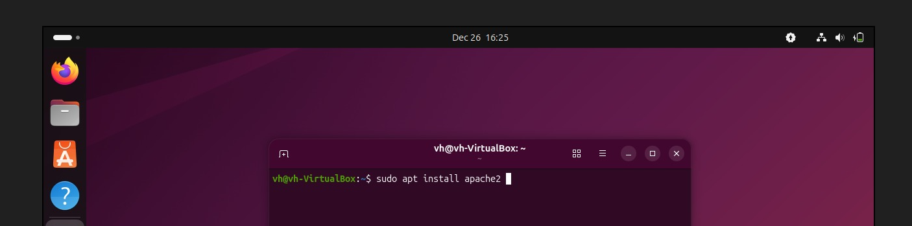
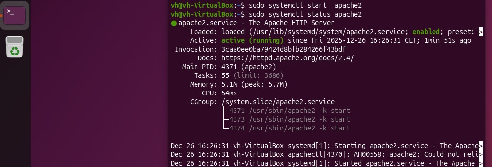
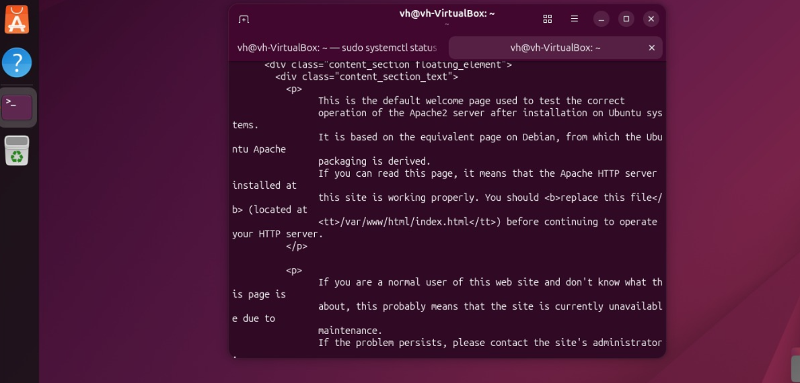
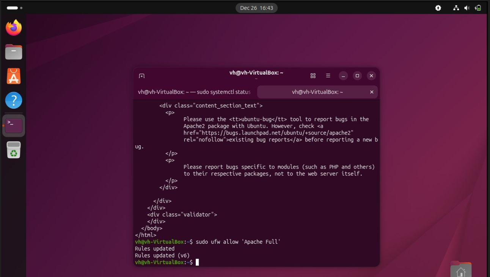
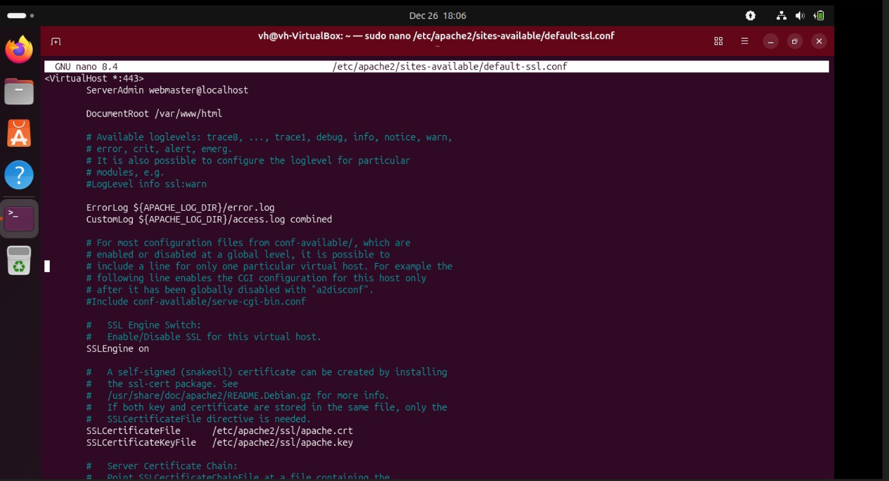

<h1 align="center">Setting Up a Secure Web Server on Ubuntu</h1>

<p align="center">Test 6. WEB SERVER SECURITY – Exercise 6<br>Curso Superior de Ciberseguridad – Deusto Formación</p>

<p align="center">
<b>Download PDF Documentation:</b><br>
<a href="Secure_Web_Server_Ubuntu_Valentina_Hatos.pdf"><b>[ English Version PDF ]</b></a><br>
<a href="Servidor_Web_Seguro_Ubuntu_Valentina_Hatos.pdf"><b>[ Versión en Español PDF ]</b></a>
</p>

| Item | Details |
|---|---|
| Exercise | Test 6. WEB SERVER SECURITY – Exercise 6 |
| Environment | Ubuntu Server on Oracle VirtualBox |
| Author | Valentina Hatos |
| Date | 26.12.2025 |

---

## Index

- [Introduction](#introduction)
- [Step 1: Update the system](#step-1-update-the-system)
- [Step 2: Install Apache](#step-2-install-apache)
- [Step 3: Check that it is active](#step-3-check-that-it-is-active)
- [Step 4: Test that it works](#step-4-test-that-it-works)
- [Step 5: Configure the firewall (to allow HTTP and HTTPS traffic)](#step-5-configure-the-firewall-to-allow-http-and-https-traffic)
- [Step 6: Directory for hosting sites](#step-6-directory-for-hosting-sites)
- [Step 7: Enable HTTPS with SSL](#step-7-enable-https-with-ssl)
- [Final result](#final-result)
- [Recommended security best practices](#recommended-security-best-practices)
- [Project Files](#project-files)

---

## Introduction

As a preliminary step, I installed Ubuntu Server on an Oracle VirtualBox virtual machine to meet the requirements of the test.

## Step 1: Update the system

```bash
sudo apt update && sudo apt upgrade -y
```

## Step 2: Install Apache

```bash
sudo apt install apache2
```



## Step 3: Check that it is active

```bash
sudo systemctl start apache2
sudo systemctl status apache2
```



## Step 4: Test that it works

```bash
curl http://localhost
```



## Step 5: Configure the firewall (to allow HTTP and HTTPS traffic)

```bash
sudo ufw allow 'Apache Full'
```



## Step 6: Directory for hosting sites

- by default, Apache uses:

```text
/var/www/html
```

## Step 7: Enable HTTPS with SSL

- install the SSL modules:

```bash
sudo apt install openssl apache2 ssl-cert -y
sudo a2enmod ssl
```

- Create a self-signed certificate:

```bash
sudo mkdir /etc/apache2/ssl
sudo openssl req -x509 -nodes -days 365 -newkey rsa:2048 \
-keyout /etc/apache2/ssl/apache.key \
-out /etc/apache2/ssl/apache.crt
```


- Configure the SSL Virtual Host:

```bash
sudo nano /etc/apache2/sites-available/default-ssl.conf
```

Add:

```apache
SSLEngine on
SSLCertificateFile /etc/apache2/ssl/apache.crt
SSLCertificateKeyFile /etc/apache2/ssl/apache.key
```



Enable the SSL site:

```bash
sudo a2ensite default-ssl.conf
sudo systemctl reload apache2
```

## Final result

Secure Ubuntu Server, with Apache installed and configured with HTTPS to protect communications.

## Recommended security best practices

- Always use HTTPS (valid certificates in production, not self-signed);
- Update the system and Apache regularly;
- Set correct permissions on /var/www/html;
- Disable unnecessary Apache modules;
- Install ModSecurity and ModEvasive for protection against XSS and DoS;
- Configure fail2ban to block brute-force attempts;
- Make regular backups;
- Monitor the server with tools such as Nagios.

---

## Project Files

| File | Description |
|---|---|
| [Secure_Web_Server_Ubuntu_Valentina_Hatos.pdf](Secure_Web_Server_Ubuntu_Valentina_Hatos.pdf) | Full document (English) |
| [Servidor_Web_Seguro_Ubuntu_Valentina_Hatos.pdf](Servidor_Web_Seguro_Ubuntu_Valentina_Hatos.pdf) | Full document (Spanish) |
| [images](images) | Terminal screenshots used in this document |
