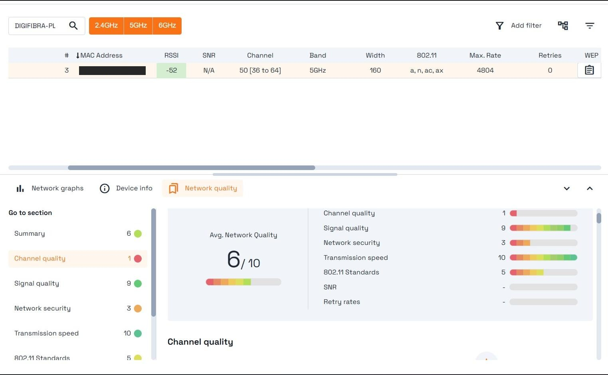
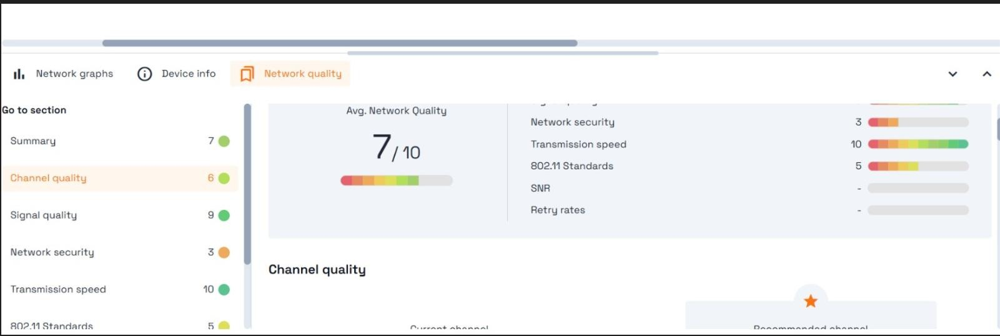

<h1 align="center">Wi-Fi Network Security Analysis</h1>

Test 2. Secure Infrastructure Configurations – Exercise 6 Curso Superior de Ciberseguridad – Deusto Formación

<b>Download PDF Documentation:</b> 
<a href="WiFi_Security_Analysis_Valentina_Hatos.pdf"><b>[ English Version PDF ]</b></a> 
<a href="Analisis_Seguridad_Red_WiFi_Valentina_Hatos.pdf"><b>[ Versión en Español PDF ]</b></a>

| Item | Details |
|---|---|
| Code | Test 2_Exercise 6 |
| Authors | Valentina Hatos |
| Date and place | 22/08/2025 – Valencia, Spain |
| Tool used | Acrylic Analyzer |

---

## Index

- [Introduction](#introduction)
- [Tool Used](#tool-used)
- [Step 1: Initial Scan](#step-1-initial-scan)
- [Step 2: Password Change](#step-2-password-change)
- [Step 3: Second Scan](#step-3-second-scan)
- [Results](#results)
- [Conclusion](#conclusion)
- [Project Files](#project-files)

---

## Introduction

The goal of this exercise is to check the security level of the Wi-Fi network my computer is connected to, before and after changing the router's Wi-Fi password.

The exercise required three steps:

1. Scan the Wi-Fi network with a network scanning tool and record its security level.
2. Change the Wi-Fi password of the router to a strong password.
3. Scan the network again with the same tool and compare the results.

## Tool Used

**Acrylic Analyzer**, a Wi-Fi scanning tool that shows the networks in range and rates each network with a Network Quality score from 0 to 10.

## Step 1: Initial Scan

- I scanned the Wi-Fi network my computer is connected to.
- The network name (SSID) is: DIGIFIBRA-PLUS-XXXX
- Network Quality: **6/10**
- The current password was weak: 12 characters, no symbols.

*Figure 1: Network_Quality_Before*

## Step 2: Password Change

- I accessed the router settings from the browser, using the IP address 192.168.1.1.
- I changed the password to a stronger one: 20 characters, including uppercase letters, lowercase letters, numbers and symbols.

## Step 3: Second Scan

- I scanned the network again with the same tool.
- Network Quality: **7/10**

*Figure 2: Network_Quality_After*

## Results

The overall score increased from 6/10 to 7/10, due to the improvement in channel quality. The Network security score remained 3/10, because the tool evaluates the encryption protocol announced by the router, not the password.

## Conclusion

The strong password (20 characters, with uppercase letters, lowercase letters, numbers and symbols) improves the protection against brute-force attacks and unauthorised access.

---

## Project Files

| File | Description |
|---|---|
| [WiFi_Security_Analysis_Valentina_Hatos.pdf](WiFi_Security_Analysis_Valentina_Hatos.pdf) | Full document (English) |
| [Analisis_Seguridad_Red_WiFi_Valentina_Hatos.pdf](Analisis_Seguridad_Red_WiFi_Valentina_Hatos.pdf) | Full document (Spanish) |
| [images](images) | Acrylic Analyzer screenshots used in this document |
